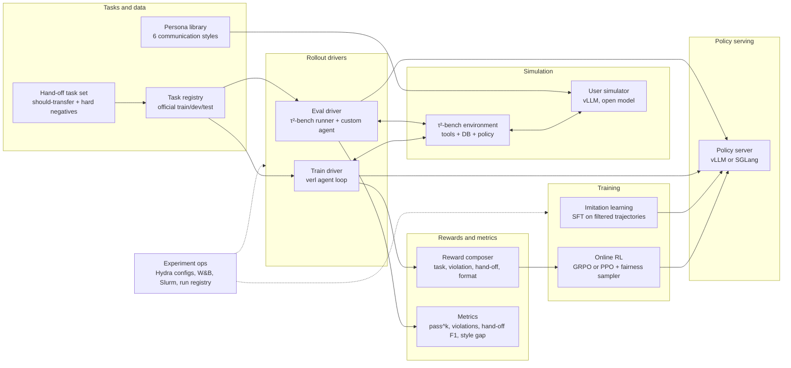
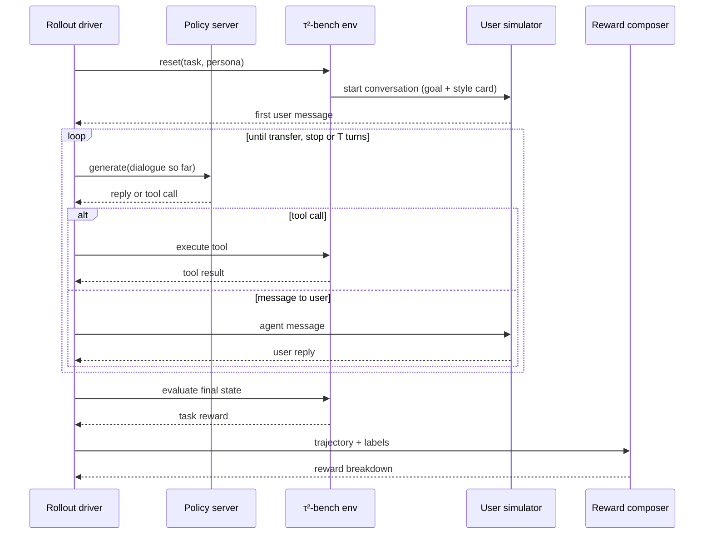
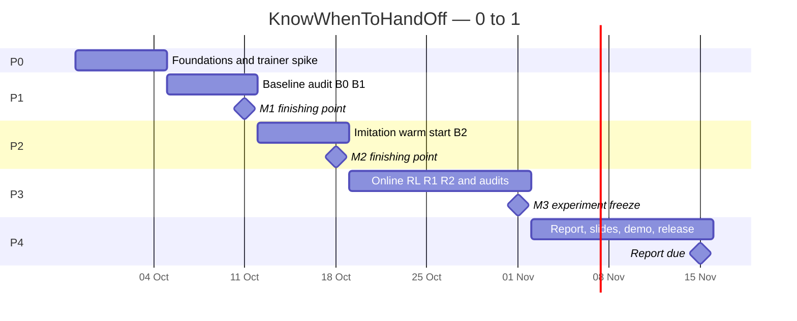

<div align="center">

# KnowWhenToHandOff

**Teach a small customer-service agent to finish the job, follow the policy, and hand off to a human at the right moment.**

**English** · [简体中文](README.zh-CN.md)

<p>


</p>

<h3>
<a href="#why-this-project">Why</a> ·
<a href="#research-questions">Research questions</a> ·
<a href="#system-architecture">Architecture</a> ·
<a href="#execution-plan">Execution plan</a> ·
<a href="#evaluation-protocol">Evaluation</a> ·
<a href="#risk-register">Risks</a> ·
<a href="AGENTS.md">AGENTS.md</a>
</h3>

</div>

<br>

> "Transfer me to a human."
> The best support agent is not the one that never hands off. It is the one that hands off at the right moment, and says why.

LLM customer-service agents are widely deployed, yet they still break business policies, hand off to human staff at the wrong time, and serve users unevenly depending on how those users talk. **KnowWhenToHandOff** trains a small open model (about 4B parameters) with multi-turn reinforcement learning on [τ²-bench](https://github.com/sierra-research/tau2-bench) so that it completes airline and retail support tasks while meeting four Responsible-AI goals: **accountability** (no policy violations), **trust** (escalating when, and only when, needed), **fairness** (similar success across communication styles) and **transparency** (citing the policy behind every refusal or hand-off). We then measure what each goal costs in task success.

> [!NOTE]
> **Status (27 Sep 2026): foundation code implemented; experiments have not run.** This README is the top-level design and the execution plan; [AGENTS.md](AGENTS.md) tells coding agents how to work in this repo. Course context: NUS CS4246/5446 *Reinforcement Learning and Sequential Decision Making*, AY2026/27 Semester 1 — proposal 28 Sep, presentation in the week of 10 Nov, report due 15 Nov 2026.

<details>
<summary><b>Contents</b></summary>

- [Highlights](#highlights)
- [Why this project](#why-this-project)
- [Research questions](#research-questions)
- [Scope](#scope)
- [Problem formulation](#problem-formulation)
- [Design principles](#design-principles)
- [System architecture](#system-architecture)
- [Episode lifecycle](#episode-lifecycle)
- [Component contracts](#component-contracts)
- [Training pipeline](#training-pipeline)
- [Evaluation protocol](#evaluation-protocol)
- [Experiment matrix](#experiment-matrix)
- [Repository layout](#repository-layout)
- [Tech stack and decisions](#tech-stack-and-decisions)
- [Compute plan](#compute-plan)
- [Execution plan](#execution-plan)
- [Risk register](#risk-register)
- [Responsible AI and limitations](#responsible-ai-and-limitations)
- [Deliverables](#deliverables)
- [References](#references)

</details>

---

## Development setup

Python 3.12 and uv are required. Run from this checkout:

```bash
uv sync --locked
uv run --locked ruff check .
uv run --locked ruff format --check .
uv run --locked pytest -q
uv build
```

Optional local configuration: `cp .env.example .env` on POSIX, or
`Copy-Item .env.example .env` in PowerShell. CPU tests require no credentials or
model servers, and network access is disabled during tests. Dependency setup can
use the network. To enable commit hooks: `uv run pre-commit install`.

T0.1 is locally verified; remote CI is pending. No trained checkpoint or benchmark
result is available. The original scientific definitions remain unchanged while
[ADR-006](docs/adr/ADR-006-preimplementation-contracts.md) is deferred.
See the [implementation status](docs/implementation-status.md) for exact boundaries.

T0.3 [offline server planning](slurm/README.md) is also implemented: validate
configuration and generate Slurm scripts locally. It does not install models,
submit jobs or change research definitions. Real cluster acceptance is pending.

Independent [run provenance and token accumulation](docs/runtime-utilities.md)
are implemented and CPU-tested. They support later experiment recording and
multi-turn training; complete evaluation, trainers and reward parity are pending.

T1.4 [six style cards and persona injection](docs/personas.md) are implemented for
serialized task dictionaries. CPU tests verify that other task fields are
unchanged; upstream Task integration and the live dialogue audit remain pending.

---

## Highlights

<table>
<tr>
<td width="33%" valign="top"><b>RL for the hand-off itself</b><br>The agent learns when to call <code>transfer_to_human_agents</code>: only when the user asks for a human, or when the policy and tools leave no way to help. Transferring too often and too rarely are both penalised.</td>
<td width="33%" valign="top"><b>Responsible AI as rewards</b><br>Policy violations, wrong hand-offs and missing policy citations are measured on every episode. Violations and wrong hand-offs are priced into the reward; citations are reported, not rewarded (see the reward-hacking rules).</td>
<td width="33%" valign="top"><b>Fair across communication styles</b><br>The same tasks are replayed by terse, verbose, impatient, non-native and low-tech-literacy simulated users. The worst-served style is up-weighted during training.</td>
</tr>
<tr>
<td width="33%" valign="top"><b>Standard, verifiable benchmark</b><br>τ²-bench airline and retail domains, official train/test splits, rewards checked against the final database state, reliability measured with pass^k.</td>
<td width="33%" valign="top"><b>One environment, two drivers</b><br>The same task, persona and reward code drives evaluation (the τ²-bench runner) and training (a verl agent loop). A parity test keeps them identical.</td>
<td width="33%" valign="top"><b>Every milestone is a finishing point</b><br>Baseline audit → imitation warm start → RL. If a later stage slips, the earlier one is still a complete, reportable result.</td>
</tr>
</table>

---

## Why this project

Three failure modes show up again and again in deployed support agents:

1. **Policy violations** — refunding a non-refundable booking, or changing an order before verifying the user's identity.
2. **Mis-timed hand-offs** — escalating what the agent could solve, or refusing to escalate when it has no legitimate way to help.
3. **Uneven service** — terse, confused or impatient users get worse outcomes for the same request.

The research gap this project targets:

| Line of work | What it does | What it leaves open |
| --- | --- | --- |
| τ-bench [1], τ²-bench [2] | Simulated tool-agent-user benchmarks with verifiable, database-state rewards | Evaluation only |
| Multi-turn RL for tool agents [3, 4] | Trains agents on τ-bench-style tasks for task success; shows naive per-turn rewards can cut success by up to 14 points [3] | Hand-off calibration, compliance, fairness |
| User-trait robustness [5, 6] | Shows agents degrade sharply with difficult users; training on diverse simulated users helps | Hand-offs and policy compliance |
| **This project** | RL that jointly targets task success, compliance, hand-off calibration and fairness across user styles | — |

---

## Research questions

| ID | Question | Primary metric | Target (course scope) |
| --- | --- | --- | --- |
| **RQ1** | Does multi-turn RL improve a ~4B open model over prompting and supervised fine-tuning? | pass^1, pass^4 on the test split | RL beats SFT with a 95% CI that excludes zero |
| **RQ2** | Can escalation-aware rewards produce calibrated hand-offs without hurting success? | Hand-off precision / recall, over-escalation rate | Higher hand-off F1 at ≤ 3 points of success cost |
| **RQ3** | Does worst-group re-weighting shrink the success gap across communication styles? | Max − min success across styles; worst-style success | Smaller gap without lowering mean success |
| **RQ4** | Which reward-hacking behaviours emerge, and which reward terms prevent them? | Transfer rate, episode length, audited failure cases | A documented taxonomy with at least one mitigation shown to work |

The **minimum viable result** is RQ1 at the imitation-learning stage plus the baseline audit of RQ2–RQ3. Everything beyond that is upside.

---

## Scope

**In scope:** τ²-bench airline and retail domains · one policy family (Qwen3, about 4B parameters; 1.7B for smoke tests) · simulated users only · offline and online RL · a small demo UI.

**Out of scope:** the telecom and banking domains · models above 8B parameters · real users or real customer data · voice · production deployment · building a new benchmark from scratch.

---

## Problem formulation

Each conversation is one episode of a **partially observable Markov decision process (POMDP)**:

| Element | In this project |
| --- | --- |
| Hidden state | The user's true goal and communication style; the full backend database |
| Observation | Dialogue history, tool results, the domain policy document |
| Action | A reply to the user, a tool call (read or write), or `transfer_to_human_agents` (ends the episode) |
| Transition | The simulated user's next message (LLM, stochastic) + deterministic tool execution on the database |
| Reward | Terminal task reward from the τ²-bench evaluator, plus Responsible-AI terms |
| Horizon | Up to *T* turns (start with 30), undiscounted |

**Reward.** Only agent-generated tokens receive gradient; user and tool tokens are masked.

$$
R(\tau) = R_{\text{task}}(\tau) - \lambda_{v}\, N_{\text{viol}}(\tau) - \lambda_{\text{FP}}\, \mathbf{1}[\text{transfer} \wedge \neg y] - \lambda_{\text{FN}}\, \mathbf{1}[\neg\text{transfer} \wedge y] - \lambda_{f}\, N_{\text{format}}(\tau)
$$

- $R_{\text{task}} \in \{0, 1\}$ comes from τ²-bench's own evaluator (database state, required actions, required information).
- $N_{\text{viol}}$ counts policy violations: write actions outside the gold action set, plus deterministic rule checks (for example, acting before identity verification).
- $y$ is the **should-transfer label**. The domain tool docstring defines it: transfer only if the user explicitly asks for a human, or if the policy and tools cannot solve the issue.
- $N_{\text{format}}$ counts malformed tool calls.
- The FP term matters because violation penalties alone make "transfer everything" look safe.

**Hand-off labels need their own dataset.** In the upstream tasks, gold hand-offs are rare: only 1 of 50 airline tasks (id 13) has `transfer_to_human_agents` in its gold actions, and retail has only a handful. Training and measuring calibration therefore needs a **hand-off task set** (task T1.3):

- **Should-transfer variants:** the user explicitly asks for a human, or asks for something no tool or policy clause allows.
- **Hard negatives:** angry or impatient users whose issue *is* solvable.

Both are built as valid τ²-bench task objects with their own evaluation criteria, kept separate from the official splits, and human-checked on a sample.

**Communication styles.** Upstream tasks leave `user_scenario.persona` empty, so a style card is injected there without touching the task facts:

- `neutral` (control)
- `terse`
- `verbose`
- `impatient`
- `non-native`
- `low-tech-literacy`

---

## Design principles

1. **Evaluation first.** The evaluation harness and the baseline audit exist before any training code.
2. **Reuse, don't rebuild.** τ²-bench owns the environment and the evaluator, vLLM owns serving, and verl owns the trainer. Our code is thin adapters, rewards, metrics and experiment glue.
3. **One environment, two drivers.** The evaluation driver and the training driver share the task registry, persona injector and reward composer, and a parity test checks that they agree.
4. **Deterministic rewards.** Training rewards come from code (the evaluator, rule checks, labels). LLM judges are used only for evaluation metrics, never as training reward.
5. **The test split is sacred.** Model and λ selection use a dev split carved from train. Test is run once per frozen checkpoint.
6. **Everything is reproducible.** Every run records its resolved config, git SHA, τ²-bench commit, model revisions and seeds.
7. **Degrade gracefully.** Every stage has a fallback, and every milestone is a finishing point.

---

## System architecture



| Layer | Responsibility | Built on |
| --- | --- | --- |
| Tasks and data | Frozen manifests for train/dev/test, hand-off task set, persona cards, should-transfer labels | τ²-bench task JSON, our generators |
| Simulation | Tool execution, database, policy text, simulated user replies | τ²-bench environment + user simulator via LiteLLM → local vLLM |
| Policy serving | OpenAI-compatible chat with tool calling for evaluation; token-in/token-out generation for training | vLLM (Qwen3 tool parser) or SGLang |
| Rollout drivers | Run episodes and emit trajectories; identical semantics in eval and train | τ²-bench agent registry; verl `AgentLoopBase` |
| Rewards and metrics | Deterministic reward breakdown per episode; evaluation metrics with confidence intervals | Our code, unit-tested |
| Training | SFT warm start; GRPO or PPO with persona-aware sampling | verl (fallback: ART or TRL) |
| Experiment ops | Configs, launch scripts, tracking, run registry, artifacts | Hydra, W&B or SwanLab, Slurm |

---

## Episode lifecycle



---

## Component contracts

Interfaces only; they fix the seams between modules before implementation starts.

```python
# handoff/envs/registry.py
class TaskRegistry:
    def load(self, domain: str, split: Literal["train", "dev", "test"],
             include_handoff_set: bool = False) -> list[TaskRef]: ...

# handoff/envs/personas.py
class PersonaInjector:
    def apply(self, task: Task, persona: Persona) -> Task: ...  # fills user_scenario.persona only

# handoff/rollout/schema.py
@dataclass
class Trajectory:
    run_id: str; task_id: str; domain: str; split: str; persona: str; seed: int
    policy_ckpt: str; user_sim: str
    messages: list[dict]            # full dialogue incl. tool calls and results
    transferred: bool; transfer_turn: int | None
    should_transfer: bool           # label
    task_reward: float              # from the τ²-bench evaluator
    violations: list[Violation]
    n_turns: int; n_tokens: int

# handoff/rewards/composer.py
class RewardComposer:
    def __call__(self, traj: Trajectory) -> RewardBreakdown: ...  # every term logged separately

# handoff/rollout/verl_loop.py
class Tau2AgentLoop(AgentLoopBase):  # verl
    async def run(self, sampling_params, **kwargs) -> AgentLoopOutput: ...  # prompt_ids, response_ids, response_mask
```

Two rules for the training driver:

- **Keep token ids.** Use token-in/token-out generation and accumulate token ids turn by turn, because re-tokenising the final messages does not reproduce the sampled ids.
- **Mask user and tool tokens.** Set `response_mask = 0` on user and tool tokens.

---

## Training pipeline

| Stage | Input | Method | Output | Gate before moving on |
| --- | --- | --- | --- | --- |
| **B0 / B1** baselines | Test split × personas | Prompted small model (B0) and a larger open model (B1) | Baseline audit table | Tool-call format errors < 5% (else change the parser or base model) |
| **B2** imitation | Successful, violation-free trajectories from a stronger model on train and the hand-off training set | SFT with loss on assistant tokens only | Warm-start checkpoint | B2 ≥ B0 on dev |
| **R1** RL (outcome) | B2 + train split | GRPO, outcome reward only, group size 8 | RL checkpoint | Stable reward curve, no collapse, dev ≥ B2 |
| **R2** RL + Responsible AI | R1 setup | Composite reward, λ grid of 3–4 points | Trade-off curves | Pick λ on dev |
| **R3** fairness (stretch) | R2 setup | Persona-aware sampler: weights ∝ exp(η · failure rate) per style | Style-gap results | Gap shrinks on dev |
| **P1** PPO (stretch) | R2 setup | Actor–critic PPO with GAE | GRPO vs PPO comparison | — |

Starting hyper-parameters (to be tuned on dev):

- 30-turn cap, 512 tokens per turn
- rollout temperature 1.0
- KL coefficient 0–0.01
- LR 1e-6 for full fine-tuning, 1e-5 for LoRA

---

## Evaluation protocol

**Splits.**

| Split | Airline | Retail | Use |
| --- | --- | --- | --- |
| Train | 30 upstream tasks | 73 upstream tasks | SFT data and RL, minus the dev tasks |
| Dev | About 20% of train | About 20% of train | Model and λ selection |
| Test | 20 upstream tasks | 40 upstream tasks | Run once per frozen checkpoint |
| Hand-off set | Same train/dev/test separation | Same train/dev/test separation | Hand-off calibration |

**Metrics.**

| Metric | Definition |
| --- | --- |
| Success (pass^1) | Mean τ²-bench task reward over tasks × trials |
| pass^k | Per task, C(c, k) / C(n, k) with c successes in n trials, averaged over tasks (k = 4) |
| Violation rate | Share of episodes with ≥ 1 policy violation (wrong write or rule breach) |
| Hand-off precision / recall / F1 | Transfer decisions against should-transfer labels |
| Over-escalation rate | Transfers on should-not-transfer episodes |
| Style gap | Max − min success across communication styles; also worst-style success |
| Citation rate | Share of refusals and hand-offs that name the policy behind them (rule match + LLM judge, evaluation only) |
| Cost | Turns, tokens and tool calls per episode |

**Statistics and robustness.**

- **Trials:** 4 trials per task in the main table (neutral persona); 2 trials per style for the style breakdown.
- **Confidence intervals:** 95% bootstrap intervals over tasks, 1,000 resamples.
- **Paired comparisons:** every model is compared on the same tasks, personas and seeds.
- **Held-out simulator:** final checkpoints are re-tested with a user simulator from a different model family.
- **Human audit:** a rubric-based review of 50 sampled dialogues per final checkpoint.
- **Frozen protocol:** the evaluation protocol is frozen at milestone M1 (11 Oct); any later change needs an ADR.

---

## Experiment matrix

| Run | Policy init | Training | Reward | Answers |
| --- | --- | --- | --- | --- |
| B0 | Qwen3-4B (prompted) | — | — | Where do we start? |
| B1 | Larger open model (prompted) | — | — | Reference ceiling |
| B2 | B0 | SFT | — | What does imitation buy? (RQ1) |
| R1 | B2 | GRPO | Task only | What does RL buy? (RQ1) |
| R2-λ | B2 | GRPO | Task + violation + hand-off + format | Compliance and hand-off vs success (RQ2) |
| R3 | B2 | GRPO + fairness sampler | As R2 | Style gap (RQ3) |
| P1 | B2 | PPO (critic) | As R2 | Critic-free vs actor–critic |
| A1 | B2 | GRPO | R2 + naive per-turn shaping | Does dense shaping hurt? (RQ4) |
| A2 | B2 | GRPO | R2 without the FP term | Does blanket transfer emerge? (RQ4) |

Key runs use 3 seeds when compute allows; otherwise 1 seed with the limitation stated.

---

## Repository layout

Planned; directories appear as the tasks that create them are done.

```text
KnowWhenToHandOff/
├── README.md · README.zh-CN.md · AGENTS.md · LICENSE (MIT, T0.1)
├── pyproject.toml            # uv, Python 3.12; tau2-bench pinned to a commit
├── configs/                  # Hydra: env/, model/, reward/, train/, eval/, slurm/
├── src/handoff/
│   ├── envs/                 # task registry, splits, personas, hand-off task generator, labels
│   ├── sim/                  # user-simulator clients and serving helpers
│   ├── agents/               # prompted baseline agent, policy client for the τ²-bench runner
│   ├── rollout/              # trajectory schema, eval driver, verl agent loop
│   ├── rewards/              # task, violation rules, hand-off, format, composer
│   ├── train/                # SFT data builder, RL launchers, fairness sampler
│   ├── eval/                 # runner, metrics, bootstrap, report tables
│   └── demo/                 # small chat UI showing hand-offs and policy citations
├── scripts/                  # CLI entry points (serve, run_eval, build_sft_data, ...)
├── slurm/                    # sbatch templates: policy server, user-sim server, train, eval
├── data/manifests/           # frozen split and hand-off manifests (small, versioned)
├── docs/
│   ├── adr/                  # architecture decision records
│   ├── metrics.md            # metric definitions (frozen at M1)
│   └── experiment-log.md     # one entry per run
├── tests/                    # unit tests: labels, rewards, metrics, parity
└── reports/                  # generated tables and figures (final versions committed)
```

---

## Tech stack and decisions

| Concern | Choice | Why | Fallback |
| --- | --- | --- | --- |
| Environment | τ²-bench (airline, retail), pinned commit | Standard, verifiable rewards, official splits, Gym interface | — |
| Policy model | Qwen3-4B-Instruct-2507 (Qwen3-1.7B for smoke tests) | Strong tool calling at 4B; known τ² SFT recipes exist | Qwen3.5-4B |
| User simulator | Open model served with vLLM (e.g., Qwen3-30B-A3B-Instruct-2507) | No API cost; fast MoE | Paid API |
| Held-out simulator | A different model family, evaluation only | Detect simulator overfitting | Smaller open model |
| Serving | vLLM with the Qwen3 tool-call parser | OpenAI-compatible and fast; LiteLLM can target it | SGLang |
| Trainer | verl (agent loop; GRPO and PPO with critic) | Multi-turn token masks, both algorithms, FSDP | ART (LoRA GRPO) or TRL; offline RFT/DPO |
| Config and tracking | Hydra + W&B (or SwanLab) | Reproducible runs, sweeps | CSV logs |
| Packaging and CI | uv, ruff, pytest, GitHub Actions (CPU tests) | Matches τ²-bench tooling | — |
| Compute | Slurm cluster with H100/H200-class GPUs | Needed for multi-turn RL | 1.7B + LoRA on 1–2 GPUs |

**Architecture decision records** (`docs/adr/`):

| ADR | Decision | Decide by |
| --- | --- | --- |
| ADR-001 | Trainer: verl vs ART vs slime vs TRL, based on a one-day spike | 4 Oct |
| ADR-002 | Base policy: Qwen3-4B-Instruct-2507 vs Qwen3.5-4B, based on B0 | 11 Oct |
| ADR-003 | User simulator and held-out simulator | 11 Oct |
| ADR-004 | Reward composition and λ grid | 18 Oct |
| ADR-005 | Evaluation protocol (frozen) | 11 Oct |

---

## Compute plan

| Job | GPUs (80 GB+ class) | Notes |
| --- | --- | --- |
| Smoke tests | 1 | Qwen3-1.7B policy + small simulator |
| User-simulator server | 1 | 30B-A3B MoE in bf16 fits on one H200 |
| SFT (4B, full) | 2–4 | Short runs; also possible with LoRA on 1 GPU |
| GRPO / PPO (4B, full) | 4 | FSDP training with the rollout engine co-located; + 1 GPU for the simulator |
| Evaluation sweep | 1–2 | Policy server + simulator; parallel episodes |

These are estimates. T0.3 measures real throughput (episodes per hour) and the plan is re-sized from that. Checkpoints and trajectories live on cluster scratch; only small manifests, configs and final reports go into git.

---

## Execution plan



Each task has a definition of done (DoD). Tick the box when the DoD is met and the commit references the task ID.

### Phase 0 — Foundations (28 Sep – 4 Oct)

- [ ] **T0.1 Scaffold the repo.**
    - *Work:* `pyproject.toml` (uv, Python 3.12), `src/handoff`, ruff, pytest, pre-commit, GitHub Actions for CPU tests, MIT LICENSE, `.gitignore`, `.env.example`.
    - *DoD:* `uv run pytest` passes and CI is green. Local checks pass; remote CI pending.
- [ ] **T0.2 Pin τ²-bench.**
    - *Work:* pin to a commit; run `tau2 run` on 5 airline tasks with any available model.
    - *DoD:* results in `data/simulations/` and a script that parses them.
- [ ] **T0.3 Bring up the cluster.**
    - *Work:* Slurm templates for the policy server, the user-simulator server and training; HF cache on scratch.
    - *DoD:* both servers answer OpenAI-style tool-calling requests from a compute node; throughput measured. Offline server planning is implemented; cluster acceptance and training templates remain pending.
- [ ] **T0.4 Trainer spike (ADR-001).**
    - *Work:* run verl's multi-turn agent-loop example end to end on 1–2 GPUs.
    - *DoD:* ADR-001 written with measured step time and the go/no-go decision.
- [ ] **T0.5 Point τ²-bench at local models.**
    - *Work:* LiteLLM model strings (`openai/<served-name>` + `api_base`) for both the agent and the simulator.
    - *DoD:* a full 5-task run with no external API.

### Phase 1 — Baseline audit, milestone M1 (5 – 11 Oct) · *finishing point*

- [ ] **T1.1 Task registry and manifests.**
    - *Work:* load the official splits; carve dev from train; freeze manifests with hashes.
    - *DoD:* a unit test proves the train, dev and test sets are disjoint.
- [ ] **T1.2 Should-transfer labels.**
    - *Work:* count gold `transfer_to_human_agents` actions; write the label rules from the domain policies.
    - *DoD:* label file + `docs/labels.md`.
- [ ] **T1.3 Hand-off task set.**
    - *Work:* generate should-transfer variants and hard negatives as valid τ²-bench tasks with evaluation criteria; target ≥ 30 of each per domain for test, and more for train.
    - *DoD:* sets with provenance; 30+ tasks hand-checked.
- [ ] **T1.4 Persona library v1.**
    - *Work:* write 6 style cards and inject them via `user_scenario.persona`.
    - *DoD:* 10 dialogues per style reviewed; style changes and task facts do not.
- [ ] **T1.5 Metrics and bootstrap.**
    - *Work:* implement every metric in the table above.
    - *DoD:* unit tests on synthetic trajectories; `docs/metrics.md` frozen (ADR-005).
- [ ] **T1.6 Baselines B0 and B1.**
    - *Work:* run on test × personas with the protocol above.
    - *DoD:* results table v1, trajectories archived, a Responsible-AI audit write-up (finishing point #1).

### Phase 2 — Imitation warm start, milestone M2 (12 – 18 Oct) · *finishing point*

- [ ] **T2.1 Teacher trajectories.**
    - *Work:* run a stronger model on train and the hand-off training set; keep only successful, violation-free, correctly transferred episodes.
    - *DoD:* SFT dataset with statistics and no test tasks.
- [ ] **T2.2 SFT of the 4B policy.**
    - *Work:* train with loss on assistant tokens only.
    - *DoD:* checkpoint + B2 evaluation.
- [ ] **T2.3 Error analysis.**
    - *Work:* compare B2 with B0 and annotate 10 failure cases.
    - *DoD:* finishing point #2.

### Phase 3 — Online RL, milestone M3 (19 Oct – 1 Nov) · *main result*

- [ ] **T3.1 `Tau2AgentLoop` for verl.**
    - *Work:* token-in/token-out generation.
    - *DoD:* a parity test on replayed trajectories matches the eval driver's reward.
- [ ] **T3.2 Reward composer.**
    - *Work:* implement the reward with per-term logging and λs set in config.
    - *DoD:* unit tests and a reward-statistics panel.
- [ ] **T3.3 R1: GRPO with outcome reward.**
    - *DoD:* learning curves; dev ≥ B2.
- [ ] **T3.4 R2: composite reward and λ sweep.**
    - *DoD:* trade-off curves; λ chosen on dev.
- [ ] **T3.5 Reward-hacking audit.**
    - *Work:* track transfer rate, episode length and simulator exploitation; review 50 dialogues.
    - *DoD:* taxonomy table (RQ4).
- [ ] **T3.6 (stretch) R3: fairness sampler.**
- [ ] **T3.7 (stretch) P1: PPO with critic; ablations A1 and A2.**
- [ ] **T3.8 Final evaluation.**
    - *Work:* test split + held-out simulator for the frozen checkpoints.
    - *DoD:* final tables; **experiment freeze on 1 Nov**.

### Phase 4 — Write-up and release (2 – 15 Nov)

- [ ] **T4.1 Reproducible figures and tables.**
    - *Work:* generate them from run IDs into `reports/`.
- [ ] **T4.2 Report.**
    - *Work:* ≤ 10 pages, Vancouver references, contribution statement and AI-use statement.
    - *Due:* 15 Nov.
- [ ] **T4.3 Slides (15 minutes) and demo.**
    - *Work:* the demo shows a hand-off with the policy citation.
    - *When:* presentation in the week of 10 Nov.
- [ ] **T4.4 Release.**
    - *Work:* results section in this README, a model card on Hugging Face marked "not for deployment", a sample of trajectories, reproduction commands.
- [ ] **T4.5 (post-course) Paper extension plan.**
    - *Work:* more domains and models, a stronger method section; target a 2027 workshop or the January 2027 ARR cycle.

**Solo cadence.** The plan assumes one person does the building, so the rhythm is weekly:

- **Monday:** pick this week's task IDs.
- **Wednesday:** run a smoke test of whatever changed.
- **Sunday:** update `docs/experiment-log.md` and tick the boxes.

If a phase slips by more than three days, cut the stretch tasks (T3.6, T3.7) first, never the evaluation.

---

## Risk register

| Risk | Likelihood | Impact | Mitigation | Trigger |
| --- | --- | --- | --- | --- |
| Multi-turn RL plumbing takes too long | High | High | ADR-001 spike in week 1; fall back to ART (LoRA GRPO) or offline RFT/DPO | Agent loop not running end to end by 18 Oct |
| GPU quota too small | Medium | High | 1.7B + LoRA, shorter horizons, API user simulator | Queue wait > 24 h or < 4 GPUs available |
| Too few training tasks (30 + 73) | High | Medium | Persona × seed replay, hand-off set, early stopping on dev | Dev reward plateaus while train reward rises |
| Ambiguous hand-off labels | Medium | High | Labels from the policy text, hand-checked sample, conservative rules | Disagreement on re-labelling > 10% |
| Noisy results on small test sets | High | Medium | pass^k, bootstrap CIs, paired comparisons, no over-claiming | CIs overlap between key runs |
| Reward hacking (blanket transfer, early stops, persuading the simulator) | Medium | High | FP term, length and transfer-rate monitors, dialogue audits | Transfer rate or episode length drifts > 2× from B2 |
| User-simulator bias or drift | Medium | Medium | Held-out simulator, fixed evaluation temperature, manual review | Success changes > 10 points between simulators |
| Upstream τ²-bench changes | Low | Medium | Pin the commit; upgrade only via an ADR | — |
| Solo workload and schedule slip | High | High | Milestones as finishing points; freeze on 1 Nov; cut stretch first | Any phase > 3 days late |

---

## Responsible AI and limitations

- **Simulated users only.** No real customers or personal data are used. All tasks are synthetic τ²-bench tasks or our derived variants.
- **Styles, not demographics.** The six communication styles describe *how* someone talks, not *who* they are. The style cards avoid stereotypes, and results are not claims about any demographic group.
- **Simulator ≠ people.** Results may not transfer to real users. We report a held-out simulator and a human dialogue audit to bound this.
- **Not for deployment.** Released checkpoints are research artefacts and carry a model card that says so.
- **Upstream licences.** τ²-bench data and code, and every model licence, are respected. Redistributed data is limited to what the upstream licences allow.

---

## Deliverables

| For | Deliverable | When |
| --- | --- | --- |
| Course | Proposal | 28 Sep 2026 |
| Course | 15-minute presentation + demo | Week of 10 Nov 2026 |
| Course | Report (≤ 10 pages, Vancouver) | 15 Nov 2026 |
| Portfolio | This repository with results, figures and reproduction commands | 15 Nov 2026 |
| Portfolio | Model card and checkpoint on Hugging Face, sample trajectories | After the report |
| Research (optional) | Workshop or conference submission | 2027 |

---

## References

1. Yao S, Shinn N, Razavi P, Narasimhan K. τ-bench: a benchmark for tool-agent-user interaction in real-world domains. arXiv:2406.12045. 2024.
2. Barres V, Dong H, Ray S, Si X, Narasimhan K. τ²-Bench: evaluating conversational agents in a dual-control environment. arXiv:2506.07982. 2025. Code: [sierra-research/tau2-bench](https://github.com/sierra-research/tau2-bench).
3. Modecrua W, Kaewtawee K, Pachtrachai K, Kraisingkorn T. Multi-turn reinforcement learning for tool-calling agents with iterative reward calibration. arXiv:2604.02869. 2026.
4. Zhao W, Wang X, Ma C, Kong L, Yang Z, Tuo M, et al. MUA-RL: multi-turn user-interacting agent reinforcement learning for agentic tool use. arXiv:2508.18669. 2025.
5. He M, Kumar A, Mackey T, Rajeev M, Zou J, Rajani N. Impatient users confuse AI agents: high-fidelity simulations of human traits for testing agents. arXiv:2510.04491. 2025.
6. Chopra H, Ghate K, Caliskan A, Kohno T, Shah C, Jaques N. Beyond cooperative simulators: generating realistic user personas for robust evaluation of LLM agents. arXiv:2605.12894. 2026.
7. Shao Z, Wang P, Zhu Q, Xu R, Song J, Bi X, et al. DeepSeekMath: pushing the limits of mathematical reasoning in open language models (GRPO). arXiv:2402.03300. 2024.
8. Schulman J, Wolski F, Dhariwal P, Radford A, Klimov O. Proximal policy optimization algorithms. arXiv:1707.06347. 2017.
9. Sagawa S, Koh PW, Hashimoto TB, Liang P. Distributionally robust neural networks for group shifts. arXiv:1911.08731. 2019.
10. verl — Agent Loop documentation: <https://verl.readthedocs.io/en/latest/advance/agent_loop.html>

<p align="center"><sub>Built by <a href="https://github.com/JaspinXu">@JaspinXu</a> for NUS CS4246/5446 (AY2026/27). Design phase — results will appear here as milestones land.</sub></p>
