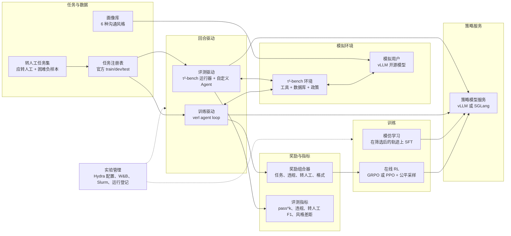
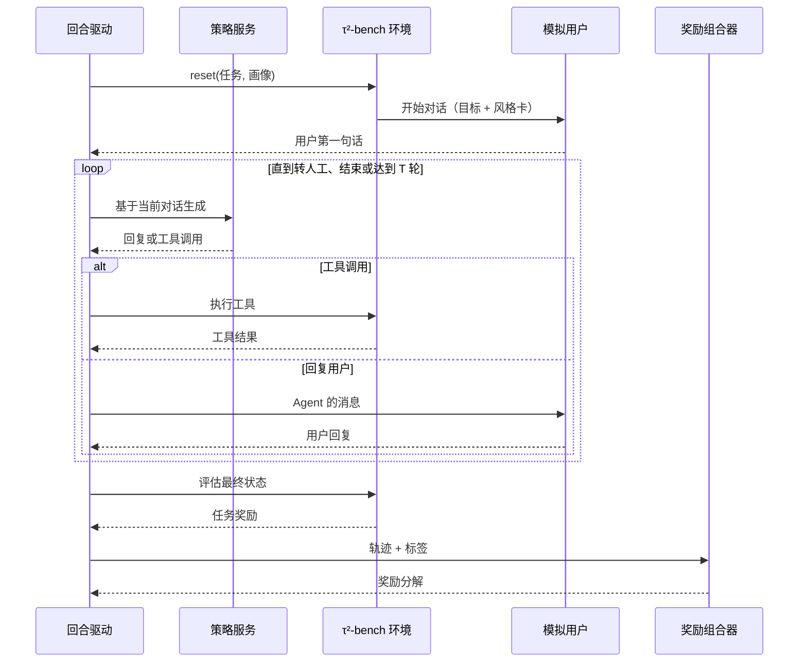
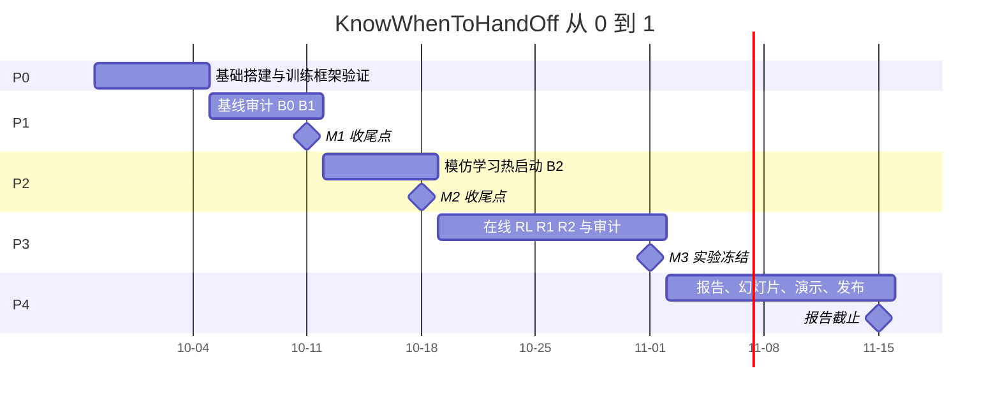

<div align="center">

# KnowWhenToHandOff

**何时转人工：训练一个小模型客服，把事办成、守住政策，并在对的时刻把用户交给人工。**

[English](README.md) · **简体中文**

<p>


</p>

<h3>
<a href="#为什么做这个项目">为什么做</a> ·
<a href="#研究问题">研究问题</a> ·
<a href="#系统架构">系统架构</a> ·
<a href="#执行计划">执行计划</a> ·
<a href="#评测协议">评测协议</a> ·
<a href="#风险登记">风险</a> ·
<a href="AGENTS.md">AGENTS.md</a>
</h3>

</div>

<br>

> "转人工！转人工！"
> 最好的客服 Agent 不是从不转人工的那个，而是在对的时刻转人工，并且说清楚为什么。

LLM 客服 Agent 已经大量上线，但仍然会违反业务政策、在错误的时机转人工，而且服务质量会随用户说话方式变化。**KnowWhenToHandOff** 在 [τ²-bench](https://github.com/sierra-research/tau2-bench) 上用多轮强化学习训练一个约 4B 参数的开源模型，让它完成航空和零售客服任务，同时满足四个 Responsible AI 目标：

- **问责**：不违反政策。
- **信任**：该转人工时才转人工。
- **公平**：对不同沟通风格的用户成功率相近。
- **透明**：每次拒绝或转人工都说明依据的政策。

最后量化每个目标要付出多少任务成功率。

> [!NOTE]
> **状态（2026 年 9 月 28 日）：部分代码已实现，训练／评测主流程尚不能运行。** 并非只差 GPU，具体缺口见[代码就绪审计](docs/code-readiness.md)。本 README 是项目设计与执行计划；[AGENTS.md](AGENTS.md) 规定仓库工作方式。课程为 NUS CS4246/5446，proposal 截止 9 月 28 日，展示在 11 月 10 日当周，报告截止 11 月 15 日。

<details>
<summary><b>目录</b></summary>

- [项目亮点](#项目亮点)
- [为什么做这个项目](#为什么做这个项目)
- [研究问题](#研究问题)
- [范围](#范围)
- [问题建模](#问题建模)
- [设计原则](#设计原则)
- [系统架构](#系统架构)
- [一个回合的生命周期](#一个回合的生命周期)
- [组件接口约定](#组件接口约定)
- [训练流水线](#训练流水线)
- [评测协议](#评测协议)
- [实验矩阵](#实验矩阵)
- [仓库结构](#仓库结构)
- [技术选型与决策](#技术选型与决策)
- [算力计划](#算力计划)
- [执行计划](#执行计划)
- [风险登记](#风险登记)
- [Responsible AI 与局限](#responsible-ai-与局限)
- [交付物](#交付物)
- [参考文献](#参考文献)

</details>

---

## 开发环境

需要 Python 3.12 和 uv。在仓库目录执行：

```bash
uv sync --locked
uv run --locked ruff check .
uv run --locked ruff format --check .
uv run --locked pytest -q
uv build
```

可选本地配置：POSIX 使用 `cp .env.example .env`，PowerShell 使用
`Copy-Item .env.example .env`。CPU 测试无需密钥或模型服务，测试期间禁用网络；
安装依赖时可以访问网络。启用提交检查：`uv run pre-commit install`。

T0.1 已通过本机检查，远程 CI 待验证。目前没有训练检查点或基准实验结果。
[ADR-006](docs/adr/ADR-006-preimplementation-contracts.md) 暂缓期间保留原研究定义。
具体实现边界见[实施状态](docs/implementation-status.md)。

T0.3 的[离线启动计划生成器](slurm/README.md)也已实现，可先在本机验证配置与
生成 Slurm 脚本。它不会安装模型、提交作业或更改研究定义；真实集群验收待进行。

独立的[运行溯源与 token 累积模块](docs/runtime-utilities.md)已实现并通过 CPU 测试。
它们为后续实验记录和多轮训练提供基础能力；完整评测、训练器与奖励一致性验证尚未实现。

T1.4 的[六种风格卡与 persona 注入](docs/personas.md)已支持序列化任务字典。
CPU 测试验证其他任务字段保持不变；上游 Task 接入与真实模拟对话审核仍待完成。

[模型响应解析器](docs/model-responses.md)已支持文本和函数调用响应解析，不会执行工具。
项目**尚未达到代码完整状态**：[流程缺口](docs/code-readiness.md)包括模型通信、基准接入、
评测、奖励、SFT 和 RL 驱动，并非只差 GPU 实验。

[仅对 assistant token 计算损失的 SFT 批处理](docs/sft-batches.md)已能在 CPU 上接收
保留的 rollout token IDs，构造补齐输入、注意力掩码与损失标签；数据资格筛选与实际
SFT 训练器仍待实现。

[离线 SFT 导出命令](docs/sft-export.md)已能流式读取 tokenized JSONL，生成带配置、
哈希及数量记录的批文件。它不会构建或认证教师数据集，也不会启动训练。

---

## 项目亮点

<table>
<tr>
<td width="33%" valign="top"><b>用 RL 学"何时转人工"</b><br>Agent 学会什么时候调用 <code>transfer_to_human_agents</code>：只在用户明确要求找人工，或按政策和现有工具确实办不了时才转。转多了、转少了都会扣分。</td>
<td width="33%" valign="top"><b>把 Responsible AI 写进奖励</b><br>每个回合都统计违规、错误转人工和缺失的政策引用。违规和错误转人工计入奖励惩罚；政策引用只作为评测指标，不进奖励（见防奖励作弊规则）。</td>
<td width="33%" valign="top"><b>对不同沟通风格一样公平</b><br>同一批任务由话少、啰嗦、急躁、非母语、不熟悉技术等不同风格的模拟用户重放；训练时给表现最差的风格加权。</td>
</tr>
<tr>
<td width="33%" valign="top"><b>标准、可验证的基准</b><br>τ²-bench 航空和零售领域，官方训练/测试划分，按最终数据库状态判定成功，用 pass^k 衡量稳定性。</td>
<td width="33%" valign="top"><b>一个环境，两套驱动</b><br>同一套任务、画像和奖励代码同时驱动评测（τ²-bench 运行器）和训练（verl agent loop），用一致性测试保证两边完全一样。</td>
<td width="33%" valign="top"><b>每个里程碑都能收尾</b><br>基线审计 → 模仿学习热启动 → 强化学习。后面的阶段出问题，前一阶段本身就是完整、可交付的结果。</td>
</tr>
</table>

---

## 为什么做这个项目

上线的客服 Agent 反复出现三类问题：

1. **违反政策**：比如给不可退款的订单退款，或者没核实身份就改订单。
2. **转人工时机不对**：自己能办的也转，或者明明没有合规办法却硬撑着不转。
3. **服务不均**：同样的请求，话少、表达不清或急躁的用户拿到的结果更差。

本项目要补的空白：

| 已有工作 | 做了什么 | 没解决什么 |
| --- | --- | --- |
| τ-bench [1]、τ²-bench [2] | 带可验证数据库奖励的"工具-Agent-用户"模拟基准 | 只做评测 |
| 工具型 Agent 的多轮 RL [3, 4] | 在 τ-bench 类任务上为任务成功率训练 Agent；发现粗糙的逐轮奖励会让成功率最多掉 14 个百分点 [3] | 转人工校准、合规、公平 |
| 用户特质鲁棒性 [5, 6] | 发现遇到难缠用户时 Agent 表现大幅下降；用多样化模拟用户训练有帮助 | 转人工和政策合规 |
| **本项目** | 用 RL 同时优化任务成功、合规、转人工校准和跨风格公平 | — |

---

## 研究问题

| 编号 | 问题 | 主要指标 | 目标（课程范围内） |
| --- | --- | --- | --- |
| **RQ1** | 多轮 RL 能否让约 4B 的开源模型超过纯提示和监督微调？ | 测试集 pass^1、pass^4 | RL 优于 SFT，95% 置信区间不含 0 |
| **RQ2** | 带转人工项的奖励能否学到校准的转人工，而不损害成功率？ | 转人工精确率/召回率、过度转人工率 | 转人工 F1 提升，成功率代价 ≤ 3 个百分点 |
| **RQ3** | 按最差组加权能否缩小不同沟通风格之间的成功率差距？ | 各风格成功率最大差、最差风格成功率 | 差距缩小且平均成功率不降 |
| **RQ4** | 会出现哪些奖励作弊行为？哪些奖励项能防住？ | 转人工率、回合长度、人工审计的失败案例 | 一份分类表，并至少证明一种缓解措施有效 |

**最小可交付结果**：模仿学习阶段的 RQ1，加上 RQ2、RQ3 的基线审计。其余都是加分项。

---

## 范围

**要做：**

- τ²-bench 的航空和零售领域；
- 一个策略模型家族（Qwen3，约 4B；冒烟测试用 1.7B）；
- 只用模拟用户；
- 离线和在线 RL；
- 一个小型演示界面。

**不做：**

- 电信和银行领域；
- 8B 以上的模型；
- 真实用户或真实客户数据；
- 语音；
- 生产部署；
- 从零造新基准。

---

## 问题建模

每段对话是一个**部分可观测马尔可夫决策过程（POMDP）**的回合：

| 要素 | 在本项目中 |
| --- | --- |
| 隐藏状态 | 用户的真实目标和沟通风格；完整的后台数据库 |
| 观测 | 对话历史、工具返回结果、领域政策文档 |
| 动作 | 回复用户、调用工具（查询或写入），或调用 `transfer_to_human_agents`（回合结束） |
| 状态转移 | 模拟用户的下一句话（LLM 生成，有随机性）+ 工具在数据库上的确定性执行 |
| 奖励 | τ²-bench 评估器给出的终局任务奖励，加上 Responsible AI 项 |
| 回合长度 | 最多 *T* 轮（先设 30），不打折扣 |

**奖励函数**（只对 Agent 生成的 token 回传梯度，用户和工具的 token 全部 mask）：

$$
R(\tau) = R_{\text{task}}(\tau) - \lambda_{v}\, N_{\text{viol}}(\tau) - \lambda_{\text{FP}}\, \mathbf{1}[\text{transfer} \wedge \neg y] - \lambda_{\text{FN}}\, \mathbf{1}[\neg\text{transfer} \wedge y] - \lambda_{f}\, N_{\text{format}}(\tau)
$$

- $R_{\text{task}} \in \{0, 1\}$ 来自 τ²-bench 自带的评估器（数据库状态、必要动作、必要信息）。
- $N_{\text{viol}}$ 统计违规次数：包括金标动作集合之外的写操作，以及确定性规则检查（例如未核实身份就执行操作）。
- $y$ 是"应当转人工"标签，定义直接来自领域工具的说明文档：只有用户明确要求人工，或按政策和现有工具无法解决时，才应转人工。
- $N_{\text{format}}$ 统计格式错误的工具调用。
- 过度转人工（FP）项很关键：只罚违规的话，"什么都转人工"反而最安全。

**转人工标签需要单独的数据集。** 上游任务里金标转人工非常少：航空 50 个任务只有 1 个（id 13）的金标动作包含 `transfer_to_human_agents`，零售也只有少数几个。因此要学会并衡量转人工校准，必须构建**转人工任务集**（任务 T1.3）：

- **应转人工的变体**：用户明确要求人工，或提出任何工具、任何政策条款都不允许的请求。
- **困难负样本**：用户很生气或很急躁，但问题其实能解决。

两者都做成合法的 τ²-bench 任务对象，带各自的评估标准，与官方划分严格分开，并人工抽检。

**沟通风格。** 上游任务的 `user_scenario.persona` 都是空的，我们在这里注入"风格卡"，不改动任何任务事实。共 6 种：

- `neutral`（对照组）
- `terse`（话少）
- `verbose`（啰嗦）
- `impatient`（急躁）
- `non-native`（非母语）
- `low-tech-literacy`（不熟悉技术）

---

## 设计原则

1. **评测先行。** 先有评测框架和基线审计，再写任何训练代码。
2. **复用，不重造。** 环境和评估器用 τ²-bench，推理服务用 vLLM，训练器用 verl。我们只写薄适配层、奖励、指标和实验胶水代码。
3. **一个环境，两套驱动。** 评测驱动和训练驱动共用任务注册表、画像注入器和奖励组合器，并用一致性测试保证两边结果一致。
4. **奖励是确定性的。** 训练奖励只来自代码（评估器、规则检查、标签）。LLM 评审只用于评测指标，绝不作为训练奖励。
5. **测试集神圣不可侵犯。** 模型选择和 λ 选择只用从训练集里切出来的开发集；测试集对每个冻结的检查点只跑一次。
6. **一切可复现。** 每次运行都记录解析后的配置、git SHA、τ²-bench 版本、模型版本和随机种子。
7. **优雅降级。** 每个阶段都有备选方案，每个里程碑都能作为收尾点。

---

## 系统架构



| 层 | 职责 | 基于 |
| --- | --- | --- |
| 任务与数据 | 冻结的 train/dev/test 清单、转人工任务集、风格卡、应转人工标签 | τ²-bench 任务 JSON、我们的生成器 |
| 模拟环境 | 工具执行、数据库、政策文本、模拟用户回复 | τ²-bench 环境 + 通过 LiteLLM 接本地 vLLM 的模拟用户 |
| 策略服务 | 评测用 OpenAI 兼容的带工具调用对话；训练用 token 进、token 出的生成接口 | vLLM（Qwen3 工具调用解析器）或 SGLang |
| 回合驱动 | 跑回合、输出轨迹；评测和训练语义完全一致 | τ²-bench agent 注册机制；verl `AgentLoopBase` |
| 奖励与指标 | 每回合确定性的奖励分解；带置信区间的评测指标 | 自己的代码，全部单测覆盖 |
| 训练 | SFT 热启动；带画像感知采样的 GRPO 或 PPO | verl（备选 ART 或 TRL） |
| 实验管理 | 配置、启动脚本、实验跟踪、运行登记、产物管理 | Hydra、W&B 或 SwanLab、Slurm |

---

## 一个回合的生命周期



---

## 组件接口约定

这里只定接口，在动手实现之前先把模块之间的边界固定下来。

```python
# handoff/envs/registry.py
class TaskRegistry:
    def load(self, domain: str, split: Literal["train", "dev", "test"],
             include_handoff_set: bool = False) -> list[TaskRef]: ...

# handoff/envs/personas.py
class PersonaInjector:
    def apply(self, task: Task, persona: Persona) -> Task: ...  # 只写 user_scenario.persona

# handoff/rollout/schema.py
@dataclass
class Trajectory:
    run_id: str; task_id: str; domain: str; split: str; persona: str; seed: int
    policy_ckpt: str; user_sim: str
    messages: list[dict]            # 完整对话，含工具调用和结果
    transferred: bool; transfer_turn: int | None
    should_transfer: bool           # 标签
    task_reward: float              # 来自 τ²-bench 评估器
    violations: list[Violation]
    n_turns: int; n_tokens: int

# handoff/rewards/composer.py
class RewardComposer:
    def __call__(self, traj: Trajectory) -> RewardBreakdown: ...  # 每一项单独记录

# handoff/rollout/verl_loop.py
class Tau2AgentLoop(AgentLoopBase):  # verl
    async def run(self, sampling_params, **kwargs) -> AgentLoopOutput: ...  # prompt_ids, response_ids, response_mask
```

训练驱动有两条规则：

- **保留生成时的 token id。** 使用 token 进、token 出的生成接口，逐轮累积 token id；对最终消息重新分词得到的 id 和采样时的不一致。
- **mask 掉用户和工具的 token。** 这些 token 的 `response_mask` 设为 0。

---

## 训练流水线

| 阶段 | 输入 | 方法 | 产出 | 进入下一阶段的门槛 |
| --- | --- | --- | --- | --- |
| **B0 / B1** 基线 | 测试集 × 画像 | 纯提示的小模型（B0）和更大的开源模型（B1） | 基线审计表 | 工具调用格式错误 < 5%（否则换解析器或基座模型） |
| **B2** 模仿学习 | 更强模型在训练集和转人工训练集上成功且无违规的轨迹 | SFT，只对 assistant token 计算损失 | 热启动检查点 | 开发集上 B2 ≥ B0 |
| **R1** RL（结果奖励） | B2 + 训练集 | GRPO，只用结果奖励，组大小 8 | RL 检查点 | 奖励曲线稳定、不崩，开发集 ≥ B2 |
| **R2** RL + Responsible AI | 同 R1 | 组合奖励，λ 网格 3–4 个点 | 权衡曲线 | 在开发集上选 λ |
| **R3** 公平（加分项） | 同 R2 | 画像感知采样：各风格权重 ∝ exp(η × 失败率) | 风格差距结果 | 开发集上差距缩小 |
| **P1** PPO（加分项） | 同 R2 | 带 GAE 的 Actor–Critic PPO | GRPO 与 PPO 对比 | — |

初始超参数（在开发集上调）：

- 最多 30 轮，每轮 512 token；
- rollout 温度 1.0；
- KL 系数 0–0.01；
- 全参微调学习率 1e-6，LoRA 1e-5。

---

## 评测协议

**数据划分。**

| 划分 | 航空 | 零售 | 用途 |
| --- | --- | --- | --- |
| 训练集 | 上游 30 个任务 | 上游 73 个任务 | SFT 数据和 RL（扣掉开发集任务） |
| 开发集 | 训练集的约 20% | 训练集的约 20% | 模型选择和 λ 选择 |
| 测试集 | 上游 20 个任务 | 上游 40 个任务 | 每个冻结检查点只跑一次 |
| 转人工任务集 | 同样按 train/dev/test 分开 | 同样按 train/dev/test 分开 | 转人工校准 |

**指标。**

| 指标 | 定义 |
| --- | --- |
| 成功率（pass^1） | τ²-bench 任务奖励在"任务 × 试验"上的平均值 |
| pass^k | 每个任务 n 次试验中成功 c 次，取 C(c, k) / C(n, k)，再对任务取平均（k = 4） |
| 违规率 | 至少出现 1 次违规（错误写操作或违反规则）的回合占比 |
| 转人工精确率 / 召回率 / F1 | 转人工决策对照"应转人工"标签 |
| 过度转人工率 | 在不应转人工的回合里转了人工的比例 |
| 风格差距 | 各沟通风格成功率的最大值减最小值；同时报告最差风格的成功率 |
| 引用率 | 拒绝和转人工中说明了政策依据的比例（规则匹配 + LLM 评审，只用于评测） |
| 成本 | 每回合的轮数、token 数、工具调用次数 |

**统计与稳健性。**

- **试验次数：** 主表中性画像每个任务 4 次试验；分风格统计每种风格 2 次试验。
- **置信区间：** 在任务上做 1,000 次 bootstrap 重采样，报 95% 置信区间。
- **配对比较：** 所有模型在同一批任务、画像和种子上比较。
- **留出模拟用户：** 最终检查点换一个不同模型家族的模拟用户重测。
- **人工审计：** 每个最终检查点按评分表抽审 50 段对话。
- **协议冻结：** 评测协议在里程碑 M1（10 月 11 日）冻结，之后任何改动都要写 ADR。

---

## 实验矩阵

| 运行 | 策略初始化 | 训练 | 奖励 | 回答的问题 |
| --- | --- | --- | --- | --- |
| B0 | Qwen3-4B（纯提示） | — | — | 起点在哪？ |
| B1 | 更大的开源模型（纯提示） | — | — | 参照上限 |
| B2 | B0 | SFT | — | 模仿学习能带来多少？（RQ1） |
| R1 | B2 | GRPO | 仅任务奖励 | RL 能带来多少？（RQ1） |
| R2-λ | B2 | GRPO | 任务 + 违规 + 转人工 + 格式 | 合规与转人工 vs 成功率（RQ2） |
| R3 | B2 | GRPO + 公平采样 | 同 R2 | 风格差距（RQ3） |
| P1 | B2 | PPO（带 critic） | 同 R2 | 无 critic vs Actor–Critic |
| A1 | B2 | GRPO | R2 + 粗糙的逐轮塑形 | 稠密塑形是否有害？（RQ4） |
| A2 | B2 | GRPO | R2 去掉 FP 项 | 会不会出现"什么都转人工"？（RQ4） |

关键运行在算力允许时跑 3 个种子，否则跑 1 个种子并写明这一局限。

---

## 仓库结构

以下是规划中的结构，对应任务完成后目录才会出现。

```text
KnowWhenToHandOff/
├── README.md · README.zh-CN.md · AGENTS.md · LICENSE（MIT，T0.1）
├── pyproject.toml            # uv，Python 3.12；tau2-bench 固定到某个 commit
├── configs/                  # Hydra：env/、model/、reward/、train/、eval/、slurm/
├── src/handoff/
│   ├── envs/                 # 任务注册表、数据划分、画像、转人工任务生成器、标签
│   ├── sim/                  # 模拟用户客户端和服务辅助
│   ├── agents/               # 纯提示基线 Agent、接 τ²-bench 运行器的策略客户端
│   ├── rollout/              # 轨迹数据结构、评测驱动、verl agent loop
│   ├── rewards/              # 任务、违规规则、转人工、格式、奖励组合器
│   ├── train/                # SFT 数据构建、RL 启动脚本、公平采样器
│   ├── eval/                 # 运行器、指标、bootstrap、报告表格
│   └── demo/                 # 展示转人工和政策引用的小型对话界面
├── scripts/                  # 命令行入口（serve、run_eval、build_sft_data 等）
├── slurm/                    # sbatch 模板：策略服务、模拟用户服务、训练、评测
├── data/manifests/           # 冻结的数据划分和转人工清单（小文件，纳入版本管理）
├── docs/
│   ├── adr/                  # 架构决策记录
│   ├── metrics.md            # 指标定义（M1 冻结）
│   └── experiment-log.md     # 每次运行一条记录
├── tests/                    # 单元测试：标签、奖励、指标、一致性
└── reports/                  # 生成的表格和图（最终版提交）
```

---

## 技术选型与决策

| 关注点 | 选择 | 理由 | 备选 |
| --- | --- | --- | --- |
| 环境 | τ²-bench（航空、零售），固定 commit | 标准、奖励可验证、官方划分、有 Gym 接口 | — |
| 策略模型 | Qwen3-4B-Instruct-2507（冒烟测试用 Qwen3-1.7B） | 4B 级别工具调用能力强；已有 τ² 的 SFT 方案 | Qwen3.5-4B |
| 模拟用户 | vLLM 部署的开源模型（例如 Qwen3-30B-A3B-Instruct-2507） | 没有 API 成本；MoE 速度快 | 付费 API |
| 留出模拟用户 | 不同模型家族，只用于评测 | 检测是否过拟合训练用的模拟用户 | 更小的开源模型 |
| 推理服务 | vLLM + Qwen3 工具调用解析器 | OpenAI 兼容、快，LiteLLM 可以直接接 | SGLang |
| 训练框架 | verl（agent loop；GRPO 和带 critic 的 PPO） | 支持多轮 token mask 和两种算法，FSDP | ART（LoRA GRPO）或 TRL；离线 RFT/DPO |
| 配置与跟踪 | Hydra + W&B（或 SwanLab） | 可复现运行、扫参 | CSV 日志 |
| 打包与 CI | uv、ruff、pytest、GitHub Actions（CPU 测试） | 与 τ²-bench 工具链一致 | — |
| 算力 | 带 H100/H200 级 GPU 的 Slurm 集群 | 多轮 RL 必需 | 1–2 张卡跑 1.7B + LoRA |

**架构决策记录**（`docs/adr/`）：

| ADR | 决策内容 | 截止 |
| --- | --- | --- |
| ADR-001 | 训练框架：verl、ART、slime、TRL 四选一，依据一天的技术验证 | 10 月 4 日 |
| ADR-002 | 基座模型：Qwen3-4B-Instruct-2507 还是 Qwen3.5-4B，依据 B0 结果 | 10 月 11 日 |
| ADR-003 | 模拟用户和留出模拟用户 | 10 月 11 日 |
| ADR-004 | 奖励组合与 λ 网格 | 10 月 18 日 |
| ADR-005 | 评测协议（冻结） | 10 月 11 日 |

---

## 算力计划

| 任务 | GPU（80 GB 以上级别） | 说明 |
| --- | --- | --- |
| 冒烟测试 | 1 | Qwen3-1.7B 策略 + 小模拟用户 |
| 模拟用户服务 | 1 | 30B-A3B MoE 的 bf16 权重一张 H200 放得下 |
| SFT（4B 全参） | 2–4 | 训练时间短；也可以单卡 LoRA |
| GRPO / PPO（4B 全参） | 4 | FSDP 训练与 rollout 引擎同卡部署；另加 1 张卡给模拟用户 |
| 评测扫描 | 1–2 | 策略服务 + 模拟用户，回合并行 |

以上都是估算。T0.3 会实测吞吐（每小时回合数），再据此调整计划。检查点和轨迹放在集群 scratch 上，git 里只放小清单、配置和最终报告。

---

## 执行计划



每个任务都有完成标准（DoD）。满足完成标准、且提交信息里带任务编号后，才打勾。

### 阶段 0：基础搭建（9 月 28 日 – 10 月 4 日）

- [ ] **T0.1 搭仓库骨架。**
    - *工作：* `pyproject.toml`（uv，Python 3.12）、`src/handoff`、ruff、pytest、pre-commit、跑 CPU 测试的 GitHub Actions、MIT LICENSE、`.gitignore`、`.env.example`。
    - *完成标准：* `uv run pytest` 通过，CI 为绿。本机检查已通过，远程 CI 待验证。
- [ ] **T0.2 固定 τ²-bench 版本。**
    - *工作：* 锁定到某个 commit；用任意可用模型在 5 个航空任务上跑 `tau2 run`。
    - *完成标准：* `data/simulations/` 下有结果，并有一个解析结果的脚本。
- [ ] **T0.3 集群环境。**
    - *工作：* 策略服务、模拟用户服务和训练的 Slurm 模板；HF 缓存放 scratch。
    - *完成标准：* 两个服务都能在计算节点上响应 OpenAI 格式的工具调用请求，并实测吞吐。离线服务计划代码已实现；真实集群验收及训练模板待完成。
- [ ] **T0.4 训练框架技术验证（ADR-001）。**
    - *工作：* 在 1–2 张卡上把 verl 的多轮 agent loop 示例端到端跑通。
    - *完成标准：* 写好 ADR-001，附实测单步耗时和是否采用的结论。
- [ ] **T0.5 让 τ²-bench 接本地模型。**
    - *工作：* Agent 和模拟用户都用 LiteLLM 模型串（`openai/<服务名>` + `api_base`）。
    - *完成标准：* 不调用任何外部 API 跑完 5 个任务。

### 阶段 1：基线审计，里程碑 M1（10 月 5 日 – 11 日）· *收尾点*

- [ ] **T1.1 任务注册表与清单。**
    - *工作：* 加载官方划分，从训练集切出开发集，冻结清单并记录哈希。
    - *完成标准：* 单元测试证明 train、dev、test 互不相交。
- [ ] **T1.2 应转人工标签。**
    - *工作：* 统计金标 `transfer_to_human_agents` 动作；依据领域政策写出标签规则。
    - *完成标准：* 标签文件 + `docs/labels.md`。
- [ ] **T1.3 转人工任务集。**
    - *工作：* 生成应转人工变体和困难负样本，做成带评估标准的合法 τ²-bench 任务；测试集每个领域每类至少 30 个，训练集更多。
    - *完成标准：* 带来源记录的任务集；人工检查 30 个以上。
- [ ] **T1.4 画像库 v1。**
    - *工作：* 写 6 张风格卡，通过 `user_scenario.persona` 注入。
    - *完成标准：* 每种风格人工看 10 段对话；风格有变化，任务事实不变。
- [ ] **T1.5 指标与 bootstrap。**
    - *工作：* 实现上面指标表里的全部指标。
    - *完成标准：* 在合成轨迹上有单元测试；`docs/metrics.md` 冻结（ADR-005）。
- [ ] **T1.6 基线 B0 与 B1。**
    - *工作：* 按上述协议在测试集 × 画像上运行。
    - *完成标准：* 结果表 v1、轨迹归档，并写一份 Responsible AI 审计报告（收尾点 #1）。

### 阶段 2：模仿学习热启动，里程碑 M2（10 月 12 日 – 18 日）· *收尾点*

- [ ] **T2.1 教师轨迹。**
    - *工作：* 用更强的模型在训练集和转人工训练集上运行，只保留成功、无违规、转人工正确的回合。
    - *完成标准：* 带统计信息的 SFT 数据集，不含任何测试任务。
- [ ] **T2.2 4B 策略的 SFT。**
    - *工作：* 只对 assistant token 计算损失。
    - *完成标准：* 检查点 + B2 评测。
- [ ] **T2.3 错误分析。**
    - *工作：* 对比 B2 和 B0，标注 10 个失败案例。
    - *完成标准：* 收尾点 #2。

### 阶段 3：在线 RL，里程碑 M3（10 月 19 日 – 11 月 1 日）· *主要结果*

- [ ] **T3.1 verl 的 `Tau2AgentLoop`。**
    - *工作：* token 进、token 出的生成。
    - *完成标准：* 在回放轨迹上的一致性测试中，奖励与评测驱动一致。
- [ ] **T3.2 奖励组合器。**
    - *工作：* 每一项单独记录，λ 在配置里设定。
    - *完成标准：* 单元测试 + 奖励统计面板。
- [ ] **T3.3 R1：只用结果奖励的 GRPO。**
    - *完成标准：* 学习曲线；开发集 ≥ B2。
- [ ] **T3.4 R2：组合奖励 + λ 扫描。**
    - *完成标准：* 权衡曲线；在开发集上选定 λ。
- [ ] **T3.5 奖励作弊审计。**
    - *工作：* 跟踪转人工率、回合长度和对模拟用户的钻空子行为；抽审 50 段对话。
    - *完成标准：* 分类表（RQ4）。
- [ ] **T3.6（加分项）R3：公平采样器。**
- [ ] **T3.7（加分项）P1：带 critic 的 PPO；消融 A1、A2。**
- [ ] **T3.8 最终评测。**
    - *工作：* 冻结检查点在测试集 + 留出模拟用户上的评测。
    - *完成标准：* 最终表格；**11 月 1 日实验冻结**。

### 阶段 4：撰写与发布（11 月 2 日 – 15 日）

- [ ] **T4.1 可复现的图表。**
    - *工作：* 按运行编号生成到 `reports/`。
- [ ] **T4.2 报告。**
    - *工作：* ≤ 10 页，Vancouver 引用格式，附贡献声明和 AI 使用声明。
    - *截止：* 11 月 15 日。
- [ ] **T4.3 15 分钟幻灯片 + 演示。**
    - *工作：* 演示一次带政策引用的转人工。
    - *时间：* 11 月 10 日当周展示。
- [ ] **T4.4 发布。**
    - *工作：* 在本 README 补结果部分；Hugging Face 模型卡注明"不可用于部署"；放出部分轨迹和复现命令。
- [ ] **T4.5（课程结束后）论文扩展计划。**
    - *工作：* 更多领域和模型，更扎实的方法部分；目标 2027 年的 workshop 或 2027 年 1 月那一轮 ARR。

**单人节奏。** 这个计划默认只有一个人在做，所以按周推进：

- **周一：** 选定本周的任务编号。
- **周三：** 对改动过的部分跑一次冒烟测试。
- **周日：** 更新 `docs/experiment-log.md` 并打勾。

任何阶段延期超过 3 天，先砍加分项（T3.6、T3.7），绝不砍评测。

---

## 风险登记

| 风险 | 可能性 | 影响 | 应对 | 触发条件 |
| --- | --- | --- | --- | --- |
| 多轮 RL 的工程打通太耗时 | 高 | 高 | 第一周做 ADR-001 技术验证；退回 ART（LoRA GRPO）或离线 RFT/DPO | 10 月 18 日前 agent loop 还跑不通 |
| GPU 配额不够 | 中 | 高 | 1.7B + LoRA、缩短回合、模拟用户改用 API | 排队超过 24 小时或可用 GPU 少于 4 张 |
| 训练任务太少（30 + 73） | 高 | 中 | 画像 × 种子重放、转人工任务集、按开发集早停 | 训练奖励上升而开发集停滞 |
| 转人工标签有歧义 | 中 | 高 | 依据政策文本定标签、人工抽检、规则取保守 | 重标不一致率超过 10% |
| 测试集小，结果噪声大 | 高 | 中 | pass^k、bootstrap 置信区间、配对比较，不夸大结论 | 关键运行之间置信区间重叠 |
| 奖励作弊（什么都转人工、提前结束、说服模拟用户） | 中 | 高 | FP 项，监控回合长度和转人工率，审计对话 | 转人工率或回合长度偏离 B2 超过 2 倍 |
| 模拟用户有偏差或漂移 | 中 | 中 | 留出模拟用户、评测温度固定、人工抽查 | 两个模拟用户下成功率相差超过 10 个百分点 |
| 上游 τ²-bench 变动 | 低 | 中 | 固定 commit；升级必须写 ADR | — |
| 一人工作量大、进度延误 | 高 | 高 | 里程碑即收尾点；11 月 1 日冻结；先砍加分项 | 任何阶段延期超过 3 天 |

---

## Responsible AI 与局限

- **只用模拟用户。** 不使用任何真实客户或个人数据；所有任务都是 τ²-bench 的合成任务或我们派生的变体。
- **风格不等于人群。** 6 种沟通风格描述的是一个人*怎么说话*，不是*他是谁*。风格卡避免刻板印象，结论也不代表任何人口群体。
- **模拟用户不等于真人。** 结论不一定能迁移到真实用户。我们用留出模拟用户和人工对话审计来界定这一差距。
- **不可用于部署。** 发布的检查点是研究产物，模型卡上会写明。
- **遵守上游许可。** 遵守 τ²-bench 数据与代码以及各模型的许可；再分发的数据只限上游许可允许的范围。

---

## 交付物

| 面向 | 交付物 | 时间 |
| --- | --- | --- |
| 课程 | Proposal | 2026 年 9 月 28 日 |
| 课程 | 15 分钟展示 + 演示 | 2026 年 11 月 10 日当周 |
| 课程 | 报告（≤ 10 页，Vancouver 引用） | 2026 年 11 月 15 日 |
| 作品集 | 带结果、图表和复现命令的本仓库 | 2026 年 11 月 15 日 |
| 作品集 | Hugging Face 上的模型卡和检查点、部分轨迹 | 报告之后 |
| 科研（可选） | Workshop 或会议投稿 | 2027 年 |

---

## 参考文献

1. Yao S, Shinn N, Razavi P, Narasimhan K. τ-bench: a benchmark for tool-agent-user interaction in real-world domains. arXiv:2406.12045. 2024.
2. Barres V, Dong H, Ray S, Si X, Narasimhan K. τ²-Bench: evaluating conversational agents in a dual-control environment. arXiv:2506.07982. 2025. 代码：[sierra-research/tau2-bench](https://github.com/sierra-research/tau2-bench)。
3. Modecrua W, Kaewtawee K, Pachtrachai K, Kraisingkorn T. Multi-turn reinforcement learning for tool-calling agents with iterative reward calibration. arXiv:2604.02869. 2026.
4. Zhao W, Wang X, Ma C, Kong L, Yang Z, Tuo M, et al. MUA-RL: multi-turn user-interacting agent reinforcement learning for agentic tool use. arXiv:2508.18669. 2025.
5. He M, Kumar A, Mackey T, Rajeev M, Zou J, Rajani N. Impatient users confuse AI agents: high-fidelity simulations of human traits for testing agents. arXiv:2510.04491. 2025.
6. Chopra H, Ghate K, Caliskan A, Kohno T, Shah C, Jaques N. Beyond cooperative simulators: generating realistic user personas for robust evaluation of LLM agents. arXiv:2605.12894. 2026.
7. Shao Z, Wang P, Zhu Q, Xu R, Song J, Bi X, et al. DeepSeekMath: pushing the limits of mathematical reasoning in open language models (GRPO). arXiv:2402.03300. 2024.
8. Schulman J, Wolski F, Dhariwal P, Radford A, Klimov O. Proximal policy optimization algorithms. arXiv:1707.06347. 2017.
9. Sagawa S, Koh PW, Hashimoto TB, Liang P. Distributionally robust neural networks for group shifts. arXiv:1911.08731. 2019.
10. verl Agent Loop 文档：<https://verl.readthedocs.io/en/latest/advance/agent_loop.html>

<p align="center"><sub>由 <a href="https://github.com/JaspinXu">@JaspinXu</a> 为 NUS CS4246/5446（2026/27 学年）构建。目前处于设计阶段，结果会随里程碑推进陆续补充。</sub></p>
